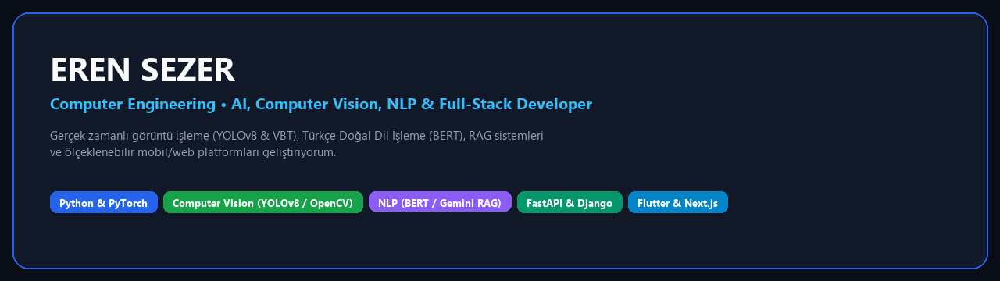

  
  
  
  
  
  
  
  

---

## 👋 Merhaba, Ben Eren Sezer!

Bilgisayar Mühendisliği öğrencisi ve **Yapay Zeka (Computer Vision & NLP)** odaklı yazılım geliştiriciyim. Gerçek zamanlı görüntü işleme sistemleri, Türkçe doğal dil işleme modelleri, RAG (Retrieval-Augmented Generation) mimarileri ve uçtan uca ölçeklenebilir web/mobil platformlar üzerine çalışıyorum.

---

## 🚀 Öne Çıkan Projelerim (Project Showcase)

### 1. 🏋️‍♂️ [BarPath-AI](https://github.com/erensezer07-gif/BarPath-AI) — Bilgisayarlı Görü ile Halter Hız (VBT) ve Form Analizi
> **YOLOv8 + Pyramidal Lucas-Kanade Optik Akış + Kalman Filtresi** hibrit mimarisiyle ağırlık antrenmanlarında barın izlediği dikey yörüngeyi (`Bar Path`), anlık dikey hızı (`m/s`) ve yatay sapmaları (`cm`) gerçek zamanlı analiz eden yapay zeka stüdyosu.
* **Teknolojiler:** `Python` · `YOLOv8` · `OpenCV` · `Kalman Filter` · `Tkinter Dark Studio`

---

### 2. 🎬 [SezerFilm (turkish-movie-review-sentiment)](https://github.com/erensezer07-gif/turkish-movie-review-sentiment) — BERT + TF-IDF Türkçe Duygu Analizi Platformu
> ~190.000 Türkçe film yorumuyla eğitilmiş **Fine-Tuned BERT (`dbmdz/bert-base-turkish-cased`) + TF-IDF Ensemble** modeli ve ironi/küfür guardrail katmanlarıyla çalışan, TMDB API entegreli Netflix tarzı film inceleme platformu.
* **Teknolojiler:** `Python` · `Django 5` · `PyTorch` · `Transformers (BERT)` · `Scikit-Learn` · `Render`

---

### 3. 🧠 [Lostick AI](https://github.com/erensezer07-gif/lostick_ai) — RAG Tabanlı Belge Analizi ve Kavram Kartı Platformu
> Yüklenen PDF, DOCX ve PPTX ders notlarından **FAISS vektör arama + Google Gemini RAG** mimarisiyle otomatik konu anlatımı, kavram kartları ve gerçek hayat kullanım örnekleri üreten eğitim platformu.
* **Teknolojiler:** `FastAPI` · `Google Gemini` · `FAISS / FastEmbed` · `PyMuPDF` · `PostgreSQL` · `Next.js`

---

### 4. 🎙️ [NeomPro](https://github.com/erensezer07-gif/NeomPro) — Türkçe Sesli Yapay Zeka Masaüstü Asistanı
> Bilgisayar açılışında arka planda sessizce çalışan, **"Neom uyan"** komutuyla uyanıp lokal **Ollama (`llama3.2:3b`)** modeliyle sohbet eden, sistem görevlerini yürüten ve **Microsoft Edge Neural TTS / Piper** ile doğal Türkçe konuşan sesli asistan.
* **Teknolojiler:** `Python` · `Ollama Llama 3.2` · `Google STT` · `Edge Neural TTS` · `Piper Offline TTS`

---

### 5. 🤝 [B2X](https://github.com/erensezer07-gif/b2x) — Kurumsal B2B Etkinlik Eşleştirme ve Oturma Planlama Platformu
> Kurumsal zirve ve iş forumlarında katılımcı profillerini karşılaştırarak her görüşme turu için kimin hangi masada oturacağını çakışmasız hesaplayan **NumPy Eşleştirme Motoru + FastAPI + Flutter** platformu.
* **Teknolojiler:** `FastAPI` · `Flutter 3.44` · `PostgreSQL 16` · `Redis & ARQ` · `NumPy` · `Docker`

---

### 6. 💼 [Meslektaş](https://github.com/erensezer07-gif/meslektas) — Profesyonel Yetkinlik Eşleşme & Anlık Sohbet Uygulaması
> LinkedIn tarzı yetkinlik profillerini Tinder tarzı kart kaydırma (swipe) mekaniğiyle birleştiren; PostgreSQL RPC (`get_deck()`), veritabanı trigger'ları, RLS ve **Supabase Realtime** ile çalışan mobil/web uygulaması.
* **Teknolojiler:** `Flutter (Dart)` · `Supabase PostgreSQL` · `Row Level Security (RLS)` · `Supabase Realtime`

---

### 7. 🌐 [Smart-Lang](https://github.com/erensezer07-gif/Smart-Lang) — AI Destekli Dil Öğrenme ve Kelime Oyunu (Android)
> Kelime ve cümle tamamlama oyunları, OpenAI destekli kişisel çalışma önerileri, Room çevrimdışı önbellek ve Firebase Firestore arkadaş liderlik tablosu içeren MVVM mimarili Android uygulaması.
* **Teknolojiler:** `Android (Java)` · `MVVM & Room DAO` · `Firebase Auth & Firestore` · `OpenAI API`

---

### 8. 🎓 [KampüsCÜ](https://github.com/erensezer07-gif/KampusCU) & [SCÜ Etkinlik Portalı](https://github.com/erensezer07-gif/CU-etkinlik-Portali)
> Sivas Cumhuriyet Üniversitesi öğrencileri için geliştirilen kampüs içi ilan (Al-Sat / Ev Arkadaşı), akademik duyuru, interaktif etkinlik takvimi ve kampüs mekan rehberi web platformları.
* **Teknolojiler:** `HTML5` · `Modüler CSS3 (Grid / Flexbox)` · `Vanilla JavaScript (ES6+)`

---

## 📊 Tüm Projeler Özeti

| Proje | Alan | Temel Teknolojiler | Durum |
|---|---|---|---|
| **[BarPath-AI](https://github.com/erensezer07-gif/BarPath-AI)** | Computer Vision & Spor Bilimi | YOLOv8, OpenCV, Kalman Filter, Tkinter | 🟢 Public |
| **[turkish-movie-review-sentiment](https://github.com/erensezer07-gif/turkish-movie-review-sentiment)** | NLP & Web | BERT, TF-IDF, Django 5, TMDB API | 🟢 Public |
| **[lostick_ai](https://github.com/erensezer07-gif/lostick_ai)** | GenAI & RAG Eğitim | FastAPI, Gemini, FAISS, Next.js, Postgres | 🟢 Public |
| **[NeomPro](https://github.com/erensezer07-gif/NeomPro)** | Sesli AI Asistan | Ollama Llama 3.2, Edge TTS, Piper, STT | 🟢 Public |
| **[b2x](https://github.com/erensezer07-gif/b2x)** | B2B SaaS & Algoritma | FastAPI, Flutter, PostgreSQL 16, Redis | 🟢 Public |
| **[meslektas](https://github.com/erensezer07-gif/meslektas)** | Mobil & Serverless | Flutter, Supabase RLS, Realtime Chat | 🟢 Public |
| **[Smart-Lang](https://github.com/erensezer07-gif/Smart-Lang)** | Mobil & AI | Android (Java), MVVM, Firebase, OpenAI | 🟢 Public |
| **[KampusCU](https://github.com/erensezer07-gif/KampusCU)** | Web Platform | HTML5, Modüler CSS3, JavaScript | 🟢 Public |
| **[CU-etkinlik-Portali](https://github.com/erensezer07-gif/CU-etkinlik-Portali)** | Web Portal | HTML5, CSS3 Grid, Fetch API, JSON | 🟢 Public |
